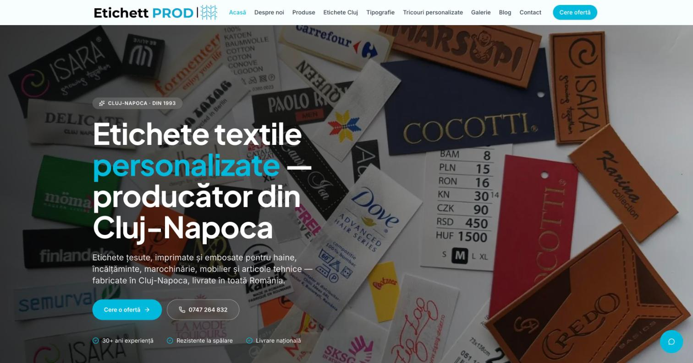

# Etichett Prod — etichete textile, Cluj-Napoca

Site-ul de prezentare al producătorului de etichete textile Etichett Prod SRL: etichete țesute, imprimate și embosate, tipografie și tricouri personalizate, cu cerere de ofertă online.

**Site live:** https://etichetetextile.ro



## Ce conține

- **Pagini de produs** pentru fiecare tip de etichetă (țesute, imprimate, satin, bumbac, termoadezive, compoziție, mărime și altele).
- **Generator de etichetă de compoziție** (`/generator-eticheta-compozitie`).
- **Cerere de ofertă** (`/cere-oferta`), galerie de lucrări și blog.
- **SEO tehnic**: canonical, Open Graph, JSON-LD și sitemap pe toate paginile.

## Tehnologii

TanStack Start (React 19, SSR pe Cloudflare Workers) · Supabase · Tailwind CSS

## Dezvoltare

Ai nevoie de Node.js 22+ și [Bun](https://bun.sh).

```sh
git clone https://github.com/alexalghisi/etichete-cluj.git
cd etichete-cluj
bun install
bun run dev
```

`bun run build` construiește varianta de producție, `bun run lint` verifică codul.
